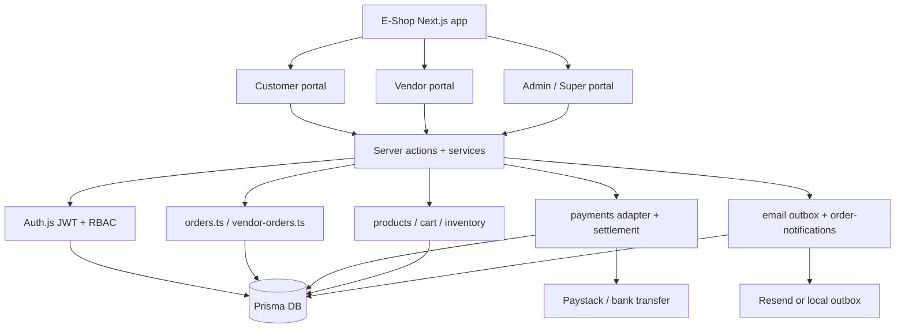
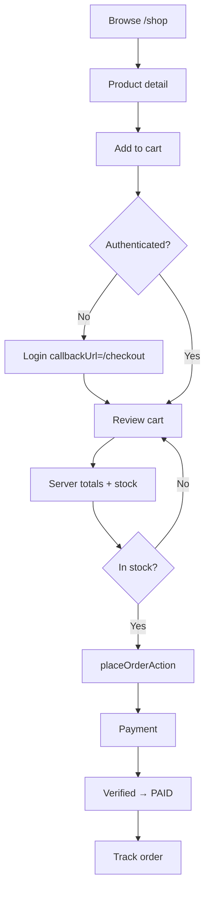

# Order management flows (Mermaid)

Companion to [README.md](./README.md). Each section matches a `.mmd` file.

## 1. System architecture

## 2. Customer checkout

## 3–10

See sibling `.mmd` files for vendor onboarding, admin management, payment verification, state machine, multi-vendor split, cancellation/refunds, role permissions, and failure recovery.
